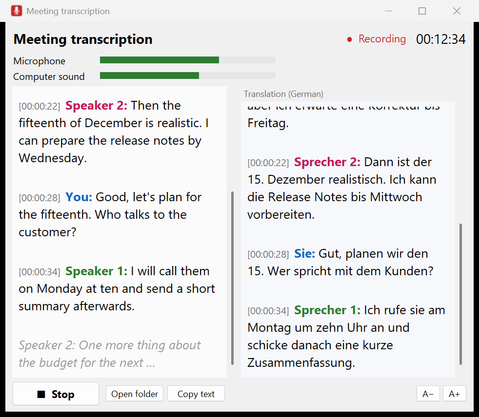
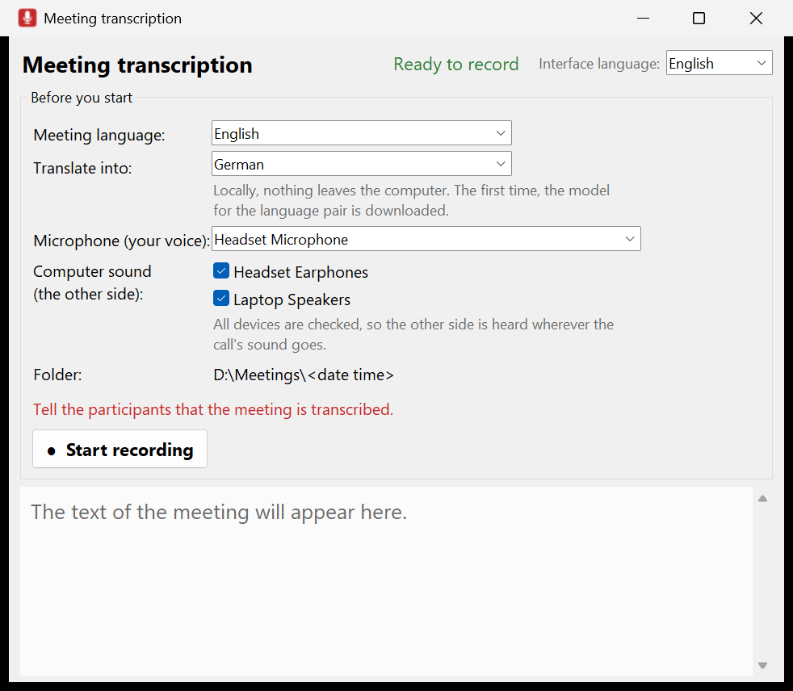
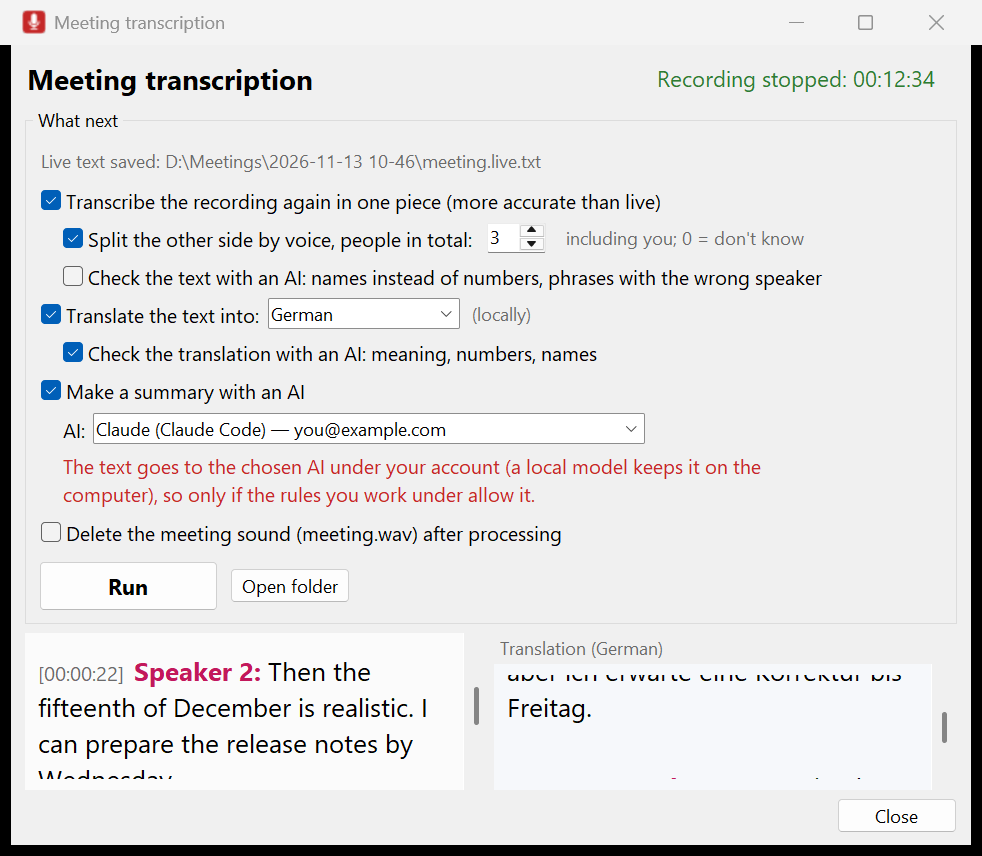

# transcribe

Meeting transcription that runs on your own computer: recordings or live calls become a
readable transcript with speakers and timestamps, optionally translated, checked and summarized.



## What it does

- **Transcribes recordings** (video or audio: mp4, mkv, mp3, wav, m4a, ...) with Whisper
  `large-v3-turbo`, on an NVIDIA GPU or the CPU. A 3-hour meeting takes about 10 minutes on the GPU.
- **Transcribes calls while they happen** (Teams, Zoom, ...): your microphone and the computer's
  sound, without recording video. Your words are labelled "You", the other side is told apart by
  voice. A draft of each phrase shows after 2–3 seconds; the final text follows in 20–30 second
  pieces, nearly as accurate as transcribing the recording afterwards.
- **Tells speakers apart** by voice ("Speaker 1", "Speaker 2", ...); on public test meetings (AMI,
  4 people) 98% of the words went to the right person when the number of speakers was given.
- **Translates** between English, German and Russian locally (Opus-MT), live in a second column
  or afterwards.
- **Optional AI steps** with an AI you have installed (Claude Code, ChatGPT through the Codex CLI,
  or a local model in Ollama or LM Studio): put in names and fix speaker borders, correct the
  translation, and write a summary that keeps every decision, task and date.
- **Interface in English, German and Russian.**

**Privacy.** Transcription, speaker separation and translation run locally; no recording or text
leaves the computer. Only the optional AI steps send the text to the AI you choose, under your
own account, and only when you tick them. Use those only for meetings whose content the rules you
work under allow. Tell the participants that a meeting is transcribed.

## Install (Windows 10/11)

Needs `git` (`winget install --id Git.Git`), about 4 GB of disk (plus about 0.45 GB per
translation direction, downloaded when first used) and an internet connection during the setup. An NVIDIA GPU is recommended; without one, everything runs on the CPU, several times
slower.

```
git clone https://github.com/sbaranau/transcribe.git C:\bin\transcribe
C:\bin\transcribe\windows\setup.cmd
```

The setup installs [uv](https://docs.astral.sh/uv/) with winget if needed, then a private Python,
the packages and the models into `app\`; nothing else on the computer is changed. At the end it
makes three shortcuts with icons in the tool folder. Update with `git pull` and run the setup
again.

Linux (`linux/setup.sh`) works for transcription and the live mode, but is less tested; see the
[technical description](docs/TECHNICAL.md#linux).

## Use

| Shortcut | What it does |
|---|---|
| **Transcribe a recording** | Drag recordings onto it. It asks the language, whether to separate speakers, translate, check or summarize, and writes the results next to the recording. |
| **Live meeting transcription** | Opens the window above. Choose the language and, if wanted, a translation, then start before the call. After Stop, the same window offers the full processing. |
| **Setup and update** | Runs the setup again. |

The shortcut names follow the interface language. You can switch it at the top right of the
window, or with `--ui-language en|de|ru`.

<p>


</p>

The results of a recording go into a folder next to it:

| File | Content |
|---|---|
| `<name>.txt`, `<name>.srt` | the transcript in paragraphs with `[hh:mm:ss]` timestamps (and speakers), and subtitles |
| `<name>.checked.txt` | with names put in and speaker borders fixed by the AI |
| `<name>.de.txt`, `<name>.de.checked.txt` | the translation, and its AI-corrected version |
| `<name>.summary.md` | the summary: main ideas, decisions, tasks, every date mentioned, open questions |

From a terminal, `windows\transcribe.cmd` takes the same choices as options, for example:

```
windows\transcribe.cmd meeting.mp4 --language en --speakers 4 --translate de --summary --srt
windows\transcribe.cmd --help
```

## Documentation

- [ИНСТРУКЦИЯ.md](ИНСТРУКЦИЯ.md): the full user guide (in Russian).
- [docs/TECHNICAL.md](docs/TECHNICAL.md): how it works, what was measured, all options.
- [docs/THIRD_PARTY.md](docs/THIRD_PARTY.md): the models and packages it uses, and their licenses.

## License

[MIT](LICENSE). The models and packages that the setup downloads come under their own licenses,
listed in [docs/THIRD_PARTY.md](docs/THIRD_PARTY.md).
