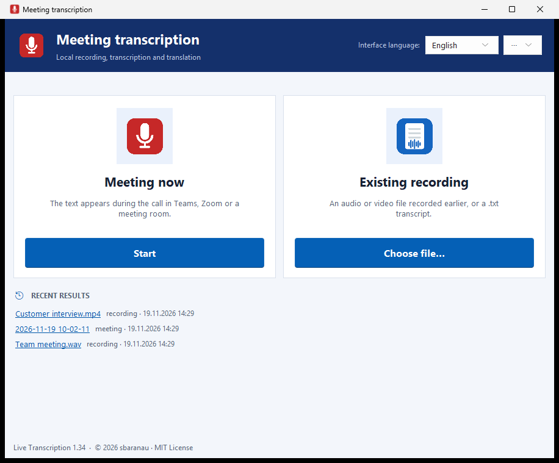
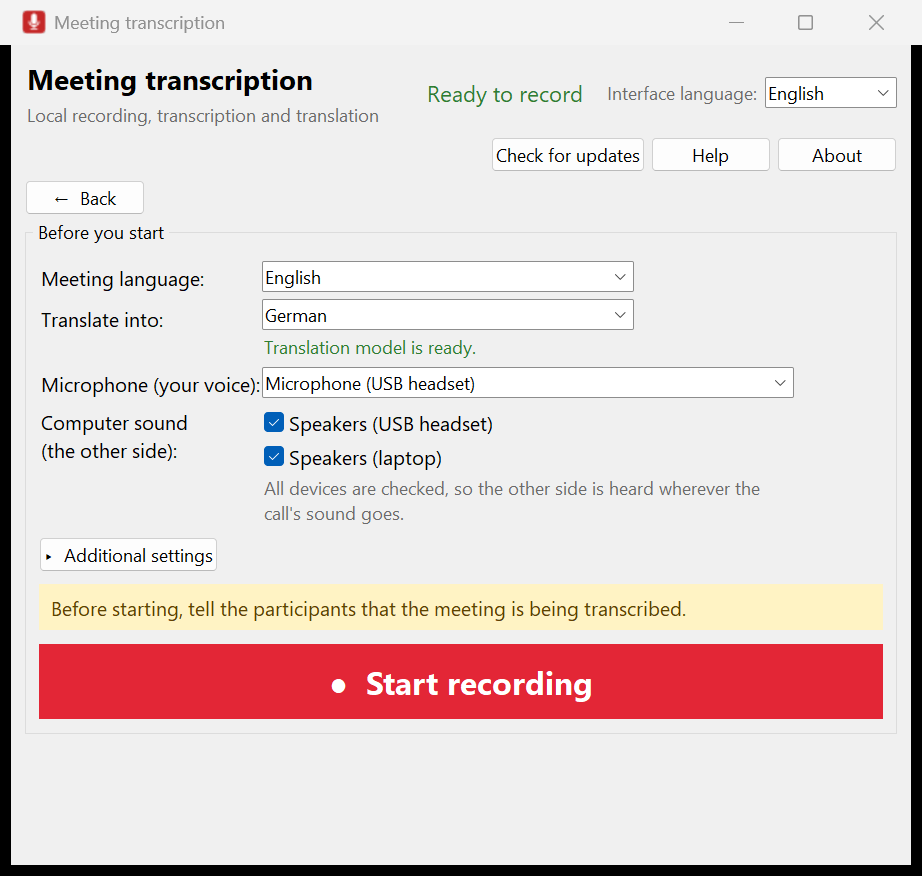
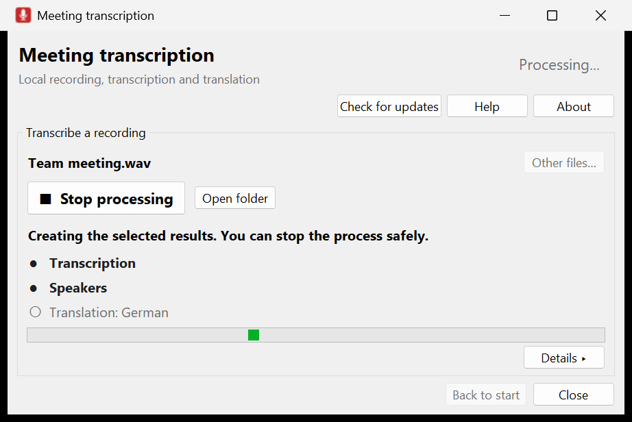
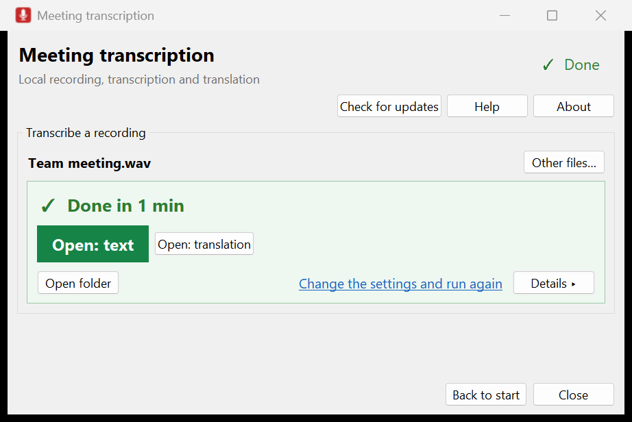

# transcribe

Private, local meeting transcription for Windows, macOS and Linux. Recordings and live calls
become a readable transcript with speakers and timestamps, optionally translated, checked and
summarized.

**Current release: v1.34** — single-file installers for Windows and macOS, while the full source
remains available for developers. See the
[changelog](CHANGELOG.md).

**[Download for Windows](https://github.com/sbaranau/transcribe/releases/download/v1.34/Live-Transcription-Windows-x64-v1.34-Setup.exe)** ·
**[Download for macOS (Apple Silicon)](https://github.com/sbaranau/transcribe/releases/download/v1.34/Live-Transcription-macOS-Apple-Silicon-v1.34.dmg)** ·
[All releases](https://github.com/sbaranau/transcribe/releases/latest) ·
[User guide in Russian](ИНСТРУКЦИЯ.md)



## What it does

- **Transcribes recordings** (video or audio: mp4, mkv, mp3, wav, m4a, ...) with Whisper
  `large-v3-turbo`, on an NVIDIA GPU or the CPU. A 3-hour meeting takes about 10 minutes on the GPU.
- **Transcribes calls while they happen** (Teams, Zoom, ...): your microphone and the computer's
  sound, without recording video. Your words are labelled "You", the other side is told apart by
  voice. A draft of each phrase shows after 2–3 seconds; the final text follows in 20–30 second
  pieces, nearly as accurate as transcribing the recording afterwards.
- **Tells speakers apart** by voice ("Speaker 1", "Speaker 2", ...); on public test meetings (AMI,
  4 people) 98% of the words went to the right person when the number of speakers was given.
- **Takes screenshots** with a button during a call (the slide or document being shown) and puts
  each one into the transcript at its moment: `meeting.md`, readable in any Markdown viewer.
- **Translates** between English, German and Russian locally (Opus-MT), live in a second column
  or afterwards.
- **Optional AI steps** with an AI you have installed and signed in to (Claude Code, ChatGPT
  through the Codex CLI, Gemini CLI, GitHub Copilot CLI, Qwen Code, or a local model in Ollama,
  LM Studio, Jan, GPT4All, llama.cpp, vLLM and others; no API keys): put in names and fix
  speaker borders, correct the translation, and write a summary that keeps every decision, task
  and date. Without any AI these options are not shown, and the window says what to install.
- **Interface in English, German and Russian.**
- **Guided live interface** that clearly separates setup, model download, recording, finalization
  and result creation, with accessible progress and error states.
- **Native macOS application** with a one-file installer, update checks, Help and About,
  an active-recording Dock icon and a new recording action that needs no restart.

**Privacy.** Transcription, speaker separation and translation run locally; no recording or text
leaves the computer. Only the optional AI steps send the text to the AI you choose, under your
own account, and only when you tick them. Use those only for meetings whose content the rules you
work under allow. Tell the participants that a meeting is transcribed.

## Install

### Windows 10/11

For a regular installation, download the single
**[Live-Transcription-Windows-x64-v1.34-Setup.exe](https://github.com/sbaranau/transcribe/releases/download/v1.34/Live-Transcription-Windows-x64-v1.34-Setup.exe)**
file (about 80 MB) and run it. It installs only for the current user, needs no administrator
rights, and adds **Live Transcription** and **Transcribe a recording** to the Start menu. The
installer optionally creates a desktop shortcut and an Explorer **Send to** entry.

On first start a setup window downloads, once, into `%LOCALAPPDATA%\Live Transcription`:

- the speech models, about 1.7 GB;
- on computers with an NVIDIA graphics card only, its CUDA libraries (cuBLAS, cuDNN, NVRTC from
  PyPI, checked against their SHA-256), about 1.3 GB download and 1.9 GB on disk. They let
  transcription run on the GPU, several times faster. Without an NVIDIA card nothing is downloaded
  and everything runs on the CPU. If this download fails, the app uses the CPU and tries again on
  the next start.

Models, CUDA libraries and preferences remain there when the application is updated, so updates
download only the small installer.

The installer is currently not code-signed. If Microsoft Defender SmartScreen appears, verify that
the file was downloaded from this repository, choose **More info**, then **Run anyway**. This warning
is separate from antivirus detection; do not disable Microsoft Defender.

Developers who want the source checkout need `git` (`winget install --id Git.Git`) and can use the
repository installation:

```
git clone https://github.com/sbaranau/transcribe.git C:\bin\transcribe
C:\bin\transcribe\windows\setup.cmd
```

The setup installs [uv](https://docs.astral.sh/uv/) with winget if needed, then a private Python,
the packages and the models into `app\`; nothing else on the computer is changed. At the end it
makes three shortcuts with icons in the tool folder. Update with `git pull` and run the setup
again.

The packaged application can be removed from **Settings → Apps → Installed apps**. Its downloaded
models, CUDA libraries and preferences are intentionally kept for later installations; remove
`%LOCALAPPDATA%\Live Transcription` separately if they are no longer needed.

### macOS

For a regular installation, download
**[Live-Transcription-macOS-Apple-Silicon-v1.34.dmg](https://github.com/sbaranau/transcribe/releases/download/v1.34/Live-Transcription-macOS-Apple-Silicon-v1.34.dmg)**.
Open that one file and
drag **Live Transcription** to **Applications**. On first start it downloads the speech models
(about 1.7 GB) into Application Support. Models, translations and preferences remain there when
the application is updated. The app quietly checks GitHub Releases and offers the download page
only when a newer version exists.

> **First launch on macOS.** This independent open-source build is not yet notarized by Apple,
> so macOS may say that it cannot verify the app for malicious software. Do not disable
> Gatekeeper. Try to open the copied app once, then open **System Settings → Privacy & Security**
> and choose **Open Anyway** for Live Transcription. After this one-time confirmation, the app
> opens normally. The DMG includes the same instructions in English and Russian. See
> [Apple's instructions](https://support.apple.com/en-us/102445).

Developers who want the source checkout can use the repository installation instead:

```bash
git clone https://github.com/sbaranau/transcribe.git
cd transcribe
open macos/setup.command
```

After source setup, open **Live Transcription** from Applications or Spotlight.
`Transcribe recording.command` in `macos/` remains available for existing recordings.
Recognition runs locally on the CPU. Translation models are downloaded with visible progress when
a language pair is first selected. Live mode records a microphone; system audio requires a virtual
CoreAudio loopback device, which can be selected as a microphone. macOS asks for microphone access
on first use.

To remove the packaged app, move it from Applications to Trash. To remove its downloaded models
and settings too, delete `~/Library/Application Support/Live Transcription`. Transcripts in
Documents are never removed automatically.

### Linux

Run `linux/setup.sh`. Linux supports files and live transcription through PulseAudio/PipeWire, but
is less tested. See the [technical description](docs/TECHNICAL.md#macos-and-linux).

## Use

| Shortcut | What it does |
|---|---|
| **Live Transcription** | Opens the home screen with two equal choices: **Meeting now** (choose the language and, if wanted, a translation, then start before the call; after Stop the same window offers the full processing) and **Existing recording**. Below them, the last five results open their folder. |
| **Transcribe a recording** | Goes straight to the processing of recordings made elsewhere (Teams, Zoom, a phone, ...): drop files onto the shortcut, send them with Explorer's **Send to**, or start it and choose them. Choose the language, speakers, translation, check or summary with check boxes; progress and buttons to open the results appear in the same window. Results go into a folder named after each recording, next to it. |
| **Setup and update** | Runs the setup again. |

The shortcut names follow the interface language. You can switch it at the top right of the
window, or with `--ui-language en|de|ru`.

The live workflow has five explicit states: preparation, translation-model download, recording,
finishing the last phrases, and creating results. The folder can be edited or chosen with the
system dialog; less-used options stay under **Additional settings**. During recording, drafts are
shown separately from confirmed text and the translation column can be hidden temporarily.
Before the start, level bars show that the microphone and the computer sound are heard.



The processing shows its steps while it runs; the full log is under **Details**. When it ends,
the results come first, and the taskbar button flashes with a notification if the window is in
the background.

<p>


</p>

The results of a recording go into a folder next to it:

| File | Content |
|---|---|
| `<name>.txt`, `<name>.srt` | the transcript in paragraphs with `[hh:mm:ss]` timestamps (and speakers), and subtitles |
| `<name>.checked.txt` | with names put in and speaker borders fixed by the AI |
| `<name>.de.txt`, `<name>.de.checked.txt` | the translation, and its AI-corrected version |
| `<name>.summary.md` | the summary: main ideas, decisions, tasks, every date mentioned, open questions |
| `meeting.md`, `screenshots/` | with screenshots taken during the call: the transcript as Markdown with each screenshot at its moment; "Export to HTML" in the window makes `meeting.html` with the pictures inside, for any browser |

From a terminal, `windows\transcribe.cmd` takes the same choices as options, for example:

```
windows\transcribe.cmd meeting.mp4 --language en --speakers 4 --translate de --summary --srt
windows\transcribe.cmd --help
```

## Code signing policy

Free code signing provided by [SignPath.io](https://about.signpath.io), certificate by
[SignPath Foundation](https://signpath.org) — applied for; until it is granted, the Windows
installers are unsigned and Windows SmartScreen warns about them (see
[Windows 10/11](#windows-1011)). The macOS DMG is not notarized by Apple.

- Only the Windows installer built by this repository's GitHub Actions workflow
  ([windows-release.yml](.github/workflows/windows-release.yml)) from a public release tag is
  submitted for signing; nothing built elsewhere is signed.
- Committers and reviewers: [sbaranau](https://github.com/sbaranau) (the only maintainer; changes
  from anyone else are reviewed before they are merged).
- Approvers: [sbaranau](https://github.com/sbaranau), who approves every signing request.
- Every installer has the product name "Live Transcription" and the version of its release, and
  can be removed in **Settings → Apps**.

### Privacy

This program does not transfer any information to other networked systems unless the person
using it starts it, with these exceptions it states in the interface: on first start it downloads
the speech models (Hugging Face, GitHub) and, on computers with an NVIDIA graphics card, the CUDA
libraries (PyPI); it checks GitHub Releases for a newer version; and only when the user ticks an
AI step (check, summary, translation check) it sends the transcript to the AI tool the user chose,
under the user's own account, where that provider's privacy policy applies. Recordings,
transcripts and translations otherwise stay on the computer.

## Documentation

- [ИНСТРУКЦИЯ.md](ИНСТРУКЦИЯ.md): the full user guide (in Russian).
- [docs/TECHNICAL.md](docs/TECHNICAL.md): how it works, what was measured, all options.
- [docs/THIRD_PARTY.md](docs/THIRD_PARTY.md): the models and packages it uses, and their licenses.
- [docs/SIGNING.md](docs/SIGNING.md): how the Windows installer gets signed and published to winget.

## License

[MIT](LICENSE). The models and packages that the setup downloads come under their own licenses,
listed in [docs/THIRD_PARTY.md](docs/THIRD_PARTY.md).
